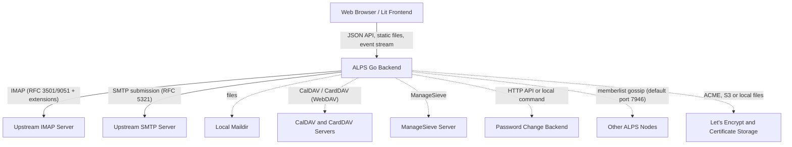

# ALPS Architecture Overview

ALPS is a webmail and Personal Information Management (PIM) suite: mail, contacts, calendars, mail filters and OpenPGP. It keeps no database of its own. It sits on top of an existing IMAP and SMTP server, works on each user's behalf with the user's own credentials, and keeps per-account data on the IMAP server itself (see [section 4](#4-stateless-persistence-imap-metadata)).

This document outlines the core architectural components, dependencies, and design decisions of the system.

---

## 1. System Overview

At a high level, ALPS is composed of two main parts:
1. **The Backend**: an HTTP server written in Go. It serves the JSON API and the embedded frontend, and talks to the mail server and the other upstream services for each signed-in user.
2. **The Frontend**: a Single Page Application (SPA) built with standard Web Components (via Lit) that communicates only with the Backend API.

Dotted edges are used only when the matching provider, plugin or feature is configured. The upstream services:

- **Mail store**: an IMAP server (IMAP4rev1/IMAP4rev2, RFC 3501/9051), or a local maildir instead ([MAILDIR.md](MAILDIR.md)).
- **SMTP**: a submission server, dialled for each send.
- **CalDAV and CardDAV**: WebDAV over HTTP(S), for the `caldav` and `carddav` plugins ([CDAV.md](CDAV.md)).
- **ManageSieve**: for the `managesieve` plugin's filters and auto-reply ([FILTERS.md](FILTERS.md)).
- **Password change**: an admin HTTP API or a local command, for the `password` plugin ([PASSWORD_CHANGE.md](PASSWORD_CHANGE.md)).
- **Other ALPS nodes**: over memberlist gossip when `[cluster]` is enabled ([CLUSTER.md](CLUSTER.md)).
- **Let's Encrypt (ACME)**, when TLS uses `letsencrypt`, with S3 for certificate storage (the default `storage_provider`; `file` keeps them on local disk instead) ([TLS.md](TLS.md)).
- **DNS SRV (RFC 6186)** lookups when the `multi` provider's `autodiscover` is on.

[OPERATIONS.md](OPERATIONS.md) lists every outbound connection the host must allow.

On IMAP, ALPS uses these extensions when the server advertises them: METADATA/METADATA-SERVER (RFC 5464), IDLE, NOTIFY, ENABLE with CONDSTORE, SORT, THREAD (REFS, REFERENCES, ORDEREDSUBJECT), QUOTA, NAMESPACE, ACL, UIDPLUS, MOVE, BINARY, LIST-EXTENDED/LIST-STATUS and MULTISEARCH. IDLE, NOTIFY and CONDSTORE are used only once they are turned on in `[server]` (see below). [MAIL_SERVER.md](MAIL_SERVER.md) says what each one is used for and what ALPS does without it.

---

## 2. Backend Architecture

The Go backend is responsible for session management, protocol parsing, and serving the API and static assets.

### Sessions & Mail Connections
ALPS keeps no shared connection pool.
- When a user signs in, the `SessionManager` creates an in-memory `Session` and opens the session's own connection to the mail server. A lost connection is reopened.
- Later HTTP requests find this `Session` through the `alps_session` cookie.
- By default (`[server] background_connection = true`), a session also opens one background connection for work the user is not waiting for: new-mail checks, sender verdicts, draft saves, push. It is opened when first needed and closed after 1 minute unused. If the server refuses it, that work runs on the session's own connection.
- SMTP is not pooled either. Each send dials the server, authenticates, runs and quits. Transient failures (a failed connection, a temporary 4xx reply) are retried, up to 3 attempts in all.
- Each session has its own in-memory cache (`[cache] enabled`, on by default; `ttl_minutes`, default 10; `max_part_kib`, default 1024).

See [CONFIGURATION.md](CONFIGURATION.md) for these keys and [MAIL_SERVER.md](MAIL_SERVER.md) for what ALPS needs from the IMAP and SMTP servers.

### New-Mail Push
With `[server] push_new_mail = true`, a session waits in IMAP IDLE on its background connection while one of its pages holds `GET /events` open. Push needs `background_connection`; without it ALPS logs that new mail is not pushed. The page opens this Server-Sent Events stream only when `GET /settings` reports `PushNewMail`. The stream sends:
- `watching`: the session now waits for news, of the Inbox alone (data `INBOX`) or of the subscribed folders too (data `SUBSCRIBED`).
- `inbox`: a message arrived in the Inbox or left it.
- `folder`, with the folder's name: the same for another folder, while the subscribed folders are watched.
- `unavailable`: the mail server cannot report changes (no IDLE). The stream ends.

A heartbeat goes out every 20 seconds. With `push_subscribed_folders = true` and a server with NOTIFY, the subscribed folders are covered as well. With `condstore = true`, each connection to a server that offers CONDSTORE turns it on (with ENABLE, where the server has it), so a listing whose messages are all still there is patched with only the flags that changed. All three keys default to false. With push off, `/events` answers 404.

The page polls in every case; push only makes the check immediate. A browser without `navigator.locks` opens no stream and only polls. Browsers offer it only in a secure context, so a deployment served over plain HTTP (other than on localhost) gets no push.

### Session Restore (`login_key`)
When `[server] login_key` (a Fernet key) is set, sign-in also issues the encrypted `alps_login_token` cookie. Like `alps_session`, it lasts 30 days when the user ticks "Stay signed in after closing the browser" on the sign-in page, and until the browser closes otherwise. When a request carries an `alps_session` the node does not know (after a restart, an idle or absolute expiry, an eviction, or on another node), ALPS signs in again from the token. A token is accepted for 30 days after it was issued. Without `login_key`, no token is issued, and in those cases the user is signed out.

A restored session for an account with a security key passes the same second-factor check as a new sign-in, unless the token records that the factor was already given. If the mail server is unreachable, the answer is 503 `mail_server_unavailable` and the token is kept. If the server refuses the password, the session and login-token cookies are cleared. See [SESSIONS.md](SESSIONS.md#session-restoration).

### Running Several Nodes
Sessions and their caches live only in the memory of the node that created them. Their uploaded attachments stay on that node too, in memory or in temporary files ([ATTACHMENTS.md](ATTACHMENTS.md)). `[cluster]` gossip (the memberlist library) carries only rate-limit events and notices that an account has enrolled a security key, and it elects the leader that may request Let's Encrypt certificates. WebAuthn update coordination goes through IMAP METADATA, not gossip.

A browser that reaches a node without its session gets a new session restored from `alps_login_token`, or a 401 without one. So every node needs the same `login_key` and `[webauthn]` settings, among others ([CLUSTER.md](CLUSTER.md#6-settings-every-node-must-share)), and the load balancer should keep each browser on one node. See [CLUSTER.md](CLUSTER.md), [RATELIMIT.md](RATELIMIT.md) and [WEBAUTHN_COORDINATION.md](WEBAUTHN_COORDINATION.md).

### Request Handling
Every response, static files included, carries the security headers (`Content-Security-Policy`, `X-Content-Type-Options: nosniff`, `X-DNS-Prefetch-Control: off`) and `X-Alps-Build`. The embedded frontend (`index.html` and its assets) is served directly, without a session.

API routes pass through a middleware chain:
1. State-changing requests (POST, PUT, DELETE, PATCH) get the CSRF origin check, which honours `[server] trusted_proxies` and `trusted_origins`.
2. The session middleware looks up the cookie, restores a session from `alps_login_token` where it can, and applies the second-factor check.
3. The plugin's handler runs.

Without a session, only `POST /session` and `DELETE /session` (sign-in and sign-out), `/webauthn/verify*` and `/plugins/<name>/assets/` are reachable. Every other API path answers 401. Sign-in and password checks go through the rate limiter ([RATELIMIT.md](RATELIMIT.md)).

### HTTP API
Each plugin's routes are served at the paths it registers, from the root of the ALPS address, with no common prefix. The frontend is their client. The groups:

| Group | Routes | For |
| --- | --- | --- |
| Session | `POST`, `GET` and `DELETE /session` | Sign in, the signed-in account and its `EnabledPlugins`, sign out ([SESSIONS.md](SESSIONS.md)) |
| Second factor | `POST /webauthn/verify/begin`, `/finish` and `/recovery`; `GET /settings/2fa` and `POST /settings/2fa/...` | The security key or a recovery code at sign-in or account switch; enrolling and removing keys, Trust Linked Accounts, new recovery codes ([WEBAUTHN.md](WEBAUTHN.md)) |
| Folders | `GET` and `POST /mailboxes`; `DELETE /mailboxes/{mbox}` and its `/status`, `/rename`, `/subscribe`, `/unsubscribe` and `/sharing` routes; `GET /quota` | The folder list and a folder's counts; creating, deleting, renaming, subscribing and sharing folders; the storage quota |
| Messages | `GET /mailboxes/{mbox}` (a page of the folder, searched with `query`); `GET /mailboxes/{mbox}/previews` (message previews the listing did not carry); `/mailboxes/{mbox}/messages/{uid}`, `.../raw` and `.../thread`; `/mailboxes/{mbox}/messages/move`, `/copy`, `/flag`; `DELETE /mailboxes/{mbox}/messages`; `POST /mailboxes/{mbox}/empty`; `/mailboxes/{mbox}/verdicts`; `GET /bimi/avatar`; `GET /proxy` | Listing, reading (a part decoded, or raw) and the conversation; moving, copying, flagging, deleting, emptying a folder; authentication verdicts and brand logos; a message's remote images, fonts and stylesheets fetched through ALPS |
| Compose | `POST /messages` | Sending a message, or saving it as a draft (`save_as_draft`) |
| Attachments | `POST /attachments`, `DELETE /attachments/{uuid}` | Uploading an attachment for the composer, and removing one ([ATTACHMENTS.md](ATTACHMENTS.md)) |
| Settings | `GET` and `PUT /settings` | The `base.settings` record ([section 4](#4-stateless-persistence-imap-metadata)), with what the page needs beside it, such as `PushNewMail` |
| Accounts | `GET` and `POST /accounts`, `DELETE /accounts/{id}`, `POST /accounts/switch` | Linked accounts and switching ([SESSIONS.md](SESSIONS.md#linked-accounts)) |
| Events | `GET /events` | The new-mail event stream ([New-Mail Push](#new-mail-push)) |
| `caldav` | `/calendar/calendars`, `/calendar/events`, `/calendar/tasks`, `/calendar/invitation` | Calendars, events, tasks, and invitations found in messages ([CDAV.md](CDAV.md)) |
| `carddav` | `/contacts` | Contacts ([CDAV.md](CDAV.md)) |
| `gpg` | `/gpg/keys` | The OpenPGP keyring ([GPG.md](GPG.md)) |
| `managesieve` | `/managesieve/script`, `/managesieve/validate` | Filters and auto-reply ([FILTERS.md](FILTERS.md)) |
| `password` | `POST /password/change` | Password change ([PASSWORD_CHANGE.md](PASSWORD_CHANGE.md)) |
| Every plugin | `GET /plugins/<name>/assets/...` | Static files from `plugins/<name>/public/assets`, relative to ALPS's working directory |

The rows above `caldav` belong to `base`, and `registerRoutes` at the top of `plugins/base/routes.go` lists them. `caldav`, `carddav` and `gpg` register theirs in their `routes.go` (`caldav` also in `tasks.go` and `invitations.go`), and `managesieve` and `password` in their `plugin.go`. The handlers there give each route's methods, parameters and answers.

### Provider Abstraction
ALPS defines a `provider.MailProvider` interface. Handlers reach mail only through it and do not send IMAP commands themselves. Three providers are compiled in:
- `imap`, for a network IMAP server.
- `maildir`, for direct access to a local maildir ([MAILDIR.md](MAILDIR.md)).
- `multi`, which routes each login by its domain to a backend of its own (type `imap` by default, or `maildir`), through `domains`, `routes`, `template`/`template_domains`, RFC 6186 SRV `autodiscover` and a `default`. Each route can also name its own `smtp`, `carddav`, `caldav`, `managesieve` and `password` settings.

A provider registers itself from `init()` with `provider.Register(name, factory)` and is chosen by `[provider] type` (default `imap`).

Besides `provider.MailProvider`, a provider may implement optional interfaces (in `provider/`) that switch features on, or let ALPS do the same work with fewer round trips:
- The provider: `ChangeTracker` (CONDSTORE), `Idler` (push), `FolderWatcher` (NOTIFY), `QuotaReader`, `FolderSharer` (ACL), `ReferenceFinder` (a conversation's replies in Sent), `AuthVerdictProvider` (senders' authentication verdicts, for brand logos), `MailboxStatusBatcher` (several folders' status in one round trip), `PreviewProvider` (message previews, PREVIEW), `ConnectionReporter` (whether the provider's connection has ended, so the session opens another) and `VerdictSharer`, which keeps the verdicts it reads in a cache the session gives every connection it opens, so a verdict read on one connection answers on a reconnect and on the background connection.
- Its store: `FreshStore` (reads an entry past the copy the connection holds), `SharedStore` (lists a subtree of entries as one consistent snapshot, which the versioned `webauthn-state/` entries need) and `UncachedStore`, whose writes keep no cached copy. The security-key record's writes use it, so the connection does not keep one cache entry for every short-lived version name.
- Its options: `ServiceRouter` (per-login service endpoints), `ServiceRoutingReporter` (whether any backend names an endpoint for a service, which decides whether `caldav`, `carddav` and `managesieve` load without a global `server`; a `ServiceRouter` without it counts as routing every service) and `AddressResolver` (the address of a login without an `@`).

The interface does not hide IMAP completely. The JSON the API returns reuses go-imap types: mailboxes embed `imap.ListData` and `imap.StatusData`, and messages embed `imapclient.FetchMessageBuffer` with its Envelope and BodyStructure. The `base` and `caldav` plugins read body structures through the `imap` provider's `IMAPBodyStructure` wrapper, which the `maildir` provider produces too. A new backend, such as JMAP, therefore has to return data that maps onto these types (see `plugins/base/provider_adapter.go`).

### Message Decoding
ALPS decodes charsets with the `go-message` charset package, which looks a name up in the IANA and WHATWG (HTML) indexes of `golang.org/x/text`. Those indexes hold `windows-1252`, `iso-8859-1`, `iso-8859-2` and `iso-8859-15`, among others. A text part in a charset it does not know is not converted and is not refused: the reader shows it as stored, its transfer encoding undone, and a draft or forward carries it on as stored, without a charset parameter. A part whose Content-Transfer-Encoding ALPS cannot undo is refused when it is decoded for reading or carried into a draft or forward. Downloading the part raw still serves its bytes.

### Plugin System
Plugins are Go packages compiled into the binary through blank imports in `cmd/alps/plugins.go`: `base`, `caldav`, `carddav`, `gpg`, `managesieve` and `password`. Each registers a loader from `init()` with `alps.RegisterPluginLoader`, usually through `alps.GoPlugin`, which also offers `AddRoute`/`GET`/`POST`/... and `AddJob` for jobs the scheduler runs every hour. Loaders run once, at startup; ALPS has no reload, so a configuration change needs a restart.

Which plugins load:
- `base` always loads. A plugin whose `[plugin.<name>]` section does not set `enabled = true` does not load.
- If any section sets `enabled = true`, only `base` and the plugins so enabled load.
- Otherwise no list is applied, and a plugin without a section loads too. `caldav` and `carddav` load only with a `server`, with `enabled = true`, or when a `multi` backend names their endpoint; `managesieve` only with a `server` or when a backend names its endpoint.
- `password` loads only when `[plugin.password] enabled = true` and an endpoint or command is configured, globally or in a `multi` backend's `password` block. `enabled = true` also applies the list above, so every other plugin wanted needs `enabled = true` beside it.

A plugin's optional frontend is `plugins/<name>/frontend/index.ts`. It registers nav tabs, settings tabs, routes and hooks with `frontend/src/plugin-registry.ts`, which shows the tabs and routes, and runs the hooks, only of the plugins that `GET /session` lists in `EnabledPlugins`. `base` has no plugin frontend: its UI is `frontend/src`. See [PLUGINS.md](PLUGINS.md), and for the individual plugins [CDAV.md](CDAV.md), [FILTERS.md](FILTERS.md), [GPG.md](GPG.md) and [PASSWORD_CHANGE.md](PASSWORD_CHANGE.md).

---

## 3. Frontend Architecture

The ALPS frontend is an SPA built from Web Components, with plugin frontends compiled in beside the core.

### Web Components & Lit
ALPS uses browser-native **Web Components** built with **Lit** (`lit.dev`) rather than a virtual-DOM framework such as React or Vue.
- UI elements are custom elements (e.g., `<alps-message-list>`, `<alps-floating-composer>`), and nearly all of them render into their own Shadow DOM.
- This keeps styling scoped to each component and prevents CSS bleed between complex views (like the calendar and the mail reader).

### Build System
The frontend is built with **TypeScript** and **Vite**: `npm run build` runs `tsc && vite build` in `frontend/`.
- The core and every plugin frontend under `plugins/*/frontend` are one TypeScript and Vite build. `frontend/src/main.ts` imports each `plugins/*/frontend/index.ts` eagerly with `import.meta.glob(..., { eager: true })`, so every plugin's entry ships whatever the config enables. Enablement is applied at runtime from `GET /session`.
- Pages and settings panes registered with `load: () => import(...)` become lazy chunks, and so do the non-English translations, core and plugin alike ([LOCALIZATION.md](LOCALIZATION.md)). Vite's `manualChunks` splits third-party code into `openpgp`, `editor`, `emoji`, `lit` and `vendor` chunks.
- The built frontend in `frontend/dist` is tracked in git and embedded at Go compile time with `//go:embed all:frontend/dist`. `go build` takes whatever was last built there, so after a frontend change run `make build-frontend` (`npm install && npm run build` in `frontend/`) before building the binary.
- `make build-linux` and `make build-freebsd` produce static amd64 binaries (`CGO_ENABLED=0`). `make build` is a plain `go build`, which follows the host's cgo setting and links dynamically wherever cgo is available.
- When it loads the frontend at startup, ALPS lays the configured `[branding]` over the embedded files and computes an ETag for each file. Every answer carries `X-Alps-Build`, a hash of the served `index.html`, so an open tab can tell that a newer frontend is being served.

### State Management
`<app-root>` creates `ComposeStore`, `SettingsStore` and `I18nStore`, and provides them, along with the module-level `LinkedAccountsStore` singleton, through `@lit/context` (`@provide`). The stores are `EventTarget` classes that dispatch a `change` event. A component gets a store with `@consume`, listens for `change`, and then calls `requestUpdate()` or updates its own reactive properties. Nothing re-renders automatically.

---

## 4. Stateless Persistence (IMAP METADATA)

ALPS has no traditional database (no PostgreSQL, MySQL, or SQLite). What it holds on the node itself (sessions, their caches and uploaded attachments) is lost on restart. [OPERATIONS.md](OPERATIONS.md) lists what ALPS writes to disk.

To persist per-account data, ALPS uses **IMAP METADATA (RFC 5464)**. It keeps the data as private server annotations (GETMETADATA/SETMETADATA on mailbox `""`), not on any mailbox. Every entry is `/private/vendor/alps/<key>` with a JSON value. The store is used when the server advertises METADATA or METADATA-SERVER.

ALPS uses the `store` abstraction to read and write these entries:
- `base.settings`: one JSON record with the user's preferences: the UI preferences (theme, colour family, layout, density, threading, themed message content, sender avatars, folder order, folders unsubscribed in ALPS), messages per page, signature, from, preferred view, check-mail interval, auto-logout, desktop and sound notifications, sort order and criteria, reply-to, bcc-myself, identities, mark-read and undo timeouts, remote content, compose format, and the language, hour and date formats and week start. Sender identities (name and address) are the `identities` array in this record; there is no separate identities entry. Because the record must fit in one METADATA entry, identities are capped at 20 and unsubscribed folders at 200 names / 16 KiB.
- `linked_accounts`: the linked accounts, each with its username, its password Fernet-encrypted with `[server] login_key`, an optional display name, and the time it was added. Linking needs `login_key`: without it, `POST /accounts` answers 400 (see [SESSIONS.md](SESSIONS.md#linked-accounts)). With a different key, the stored passwords cannot be decrypted, and the accounts have to be linked again.
- `webauthn`: the account's 2FA record: the user ID, whether 2FA is enabled, the security keys, the trust-linked-accounts setting, and the unused recovery codes, which are kept only as hashes. On IMAP METADATA the record is kept as versioned entries under `webauthn-state/<number>-<id>`, which coordinate updates across ALPS instances: the newest committed one is the record, and the `webauthn` entry is read only until the first committed version exists. The maildir store keeps the record in `webauthn`. See [WEBAUTHN.md](WEBAUTHN.md) and [WEBAUTHN_COORDINATION.md](WEBAUTHN_COORDINATION.md).
- `gpg_keys`: the `gpg` plugin's keyring (`public_key`, and `encrypted_private_key`, protected by the user's passphrase). See [GPG.md](GPG.md).

There are no other plugin entries. CalDAV, CardDAV and ManageSieve keep nothing in METADATA: their servers come from `[plugin.<name>] server` or from the `multi` provider's routes.

### Without METADATA
Persistence needs an IMAP server that advertises METADATA or METADATA-SERVER. Without it, ALPS logs once "IMAP server doesn't support the METADATA extension, using transient store instead" and keeps entries only in the memory of that one mail connection. Nothing saved then survives a reconnect or a new sign-in, and the session's background connection does not see it. Use the transient store only for trying ALPS out.

The `maildir` provider keeps the same entries, except the versioned `webauthn-state/` ones, in a JSON file, `alps_store.json`, at the root of the user's maildir ([MAILDIR.md](MAILDIR.md)).

### Why IMAP Metadata?
1. **No Database to Run**: Administrators do not need to set up, secure, or back up a separate database to run ALPS.
2. **Portability**: The data belongs to the account, not to the ALPS server. It follows a mailbox to another IMAP server only if the migration copies the private server METADATA under `/private/vendor/alps/` (including `webauthn-state/`); a migration that copies only messages leaves it behind. After the move, linked accounts also need the same `[server] login_key`, and security keys the same `[webauthn] rpid`, on the ALPS that serves the account.
3. **Data Stays with the Account**: An account's settings and keys are kept on the same server as its mail, rather than on the ALPS host.
